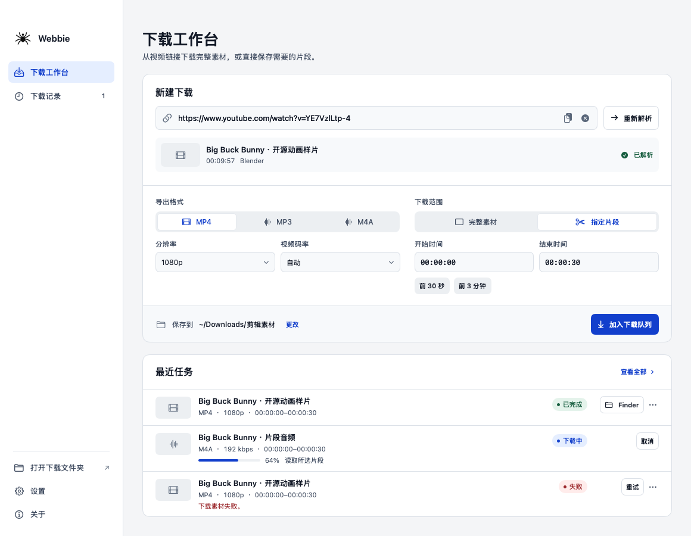

#  Webbie

[简体中文](README.md) · [English](README.en.md) · **日本語**

> 1 時間の動画。編集に使うのは冒頭の 30 秒だけ。

以前は動画を丸ごとダウンロードして、編集ソフトに入れてから、メモしておいた時間を探していました。この作業を何度も繰り返すうちに、欲しい区間の動画や音声をダウンロードできる Mac アプリ **Webbie** を自分で作りました。

[**macOS 版をダウンロード**](https://github.com/raynpan316-cyber/webbie/releases/latest) · [インストール](#インストール) · [ソースからビルド](#ソースからビルド)

## 冒頭の 30 秒を保存する

1. **リンクを貼る。** 作業画面に動画の URL を貼って「リンクを解析」を押します。
2. **区間を選ぶ。** 「範囲を指定」に切り替え、「最初の30秒」を選びます。途中から切り出すときは、開始時刻と終了時刻を入力します。
3. **Mac に保存する。** MP4 と利用可能な解像度を選び、キューに追加します。完了したら、タスクの横にある **Finder** から保存先を開けます。



## YouTube ダウンロードの使い方

- **YouTube Clip Downloader（YouTube 動画の区間指定）** · 使いたい発言があれば、`00:12:40 → 00:13:10` と入力してその 30 秒を書き出します。冒頭なら最初の 3 分のプリセットも使えます。
- **YouTube Video Downloader（YouTube 動画のダウンロード）** · 「全体」を選び、利用可能な解像度と動画ビットレートを指定します。複数の素材をキューに追加し、失敗したタスクは履歴から再試行できます。
- **YouTube MP4 Download / YouTube MP3 Download** · 動画を MP4 で保存できます。音声はビットレートを選んで MP3 または M4A で書き出せます。必要な音声の区間だけを指定することもできます。

YouTube、Bilibili、TikTok、抖音、小紅書などのリンクを読み込めます。利用できる形式や画質、区間指定の可否は、リンク先や yt-dlp の対応状況によって変わります。ダウンロード処理と履歴の保存は Mac 上で行います。設定で簡体字中国語、英語、日本語を切り替えられます。

## インストール

**Apple シリコン搭載の Mac** と **macOS 14 以降**が必要です。

1. [Homebrew](https://brew.sh/) をインストールし、ターミナルで次のコマンドを実行します。

   ```bash
   brew install yt-dlp ffmpeg deno
   ```

2. [Releases](https://github.com/raynpan316-cyber/webbie/releases) から `Webbie-macOS-arm64.zip` をダウンロードします。展開した `Webbie.app` を「アプリケーション」に移動します。
3. Finder の「アプリケーション」フォルダで Webbie をダブルクリックします。

### 初回起動がブロックされたとき

リリース版は ad hoc 署名を使用しており、Apple の公証を受けていません。このリポジトリの [GitHub Releases](https://github.com/raynpan316-cyber/webbie/releases) からダウンロードしたことを確認してから、以下の手順で開きます。

1. 警告ダイアログの **「完了」** をクリックします。
2. **「システム設定」→「プライバシーとセキュリティ」** を開き、**「セキュリティ」** までスクロールします。Webbie の **「このまま開く」** をクリックします。
3. 次のダイアログで **「開く」** をクリックします。以降はダブルクリックで起動できます。

「このまま開く」が表示されない場合は、Finder で `Webbie.app` をもう一度ダブルクリックし、すぐにシステム設定に戻って確認してください。[Apple サポート](https://support.apple.com/ja-jp/102445)

## ソースからビルド

`xcode-select --install` で Xcode Command Line Tools をインストールし、リポジトリのルートで次のコマンドを実行します。

```bash
./build.sh
```

アプリは `build/Webbie.app` に生成され、上記のダウンロード用ツールを使用します。SDK が複数ある場合は、Swift ツールチェーンに対応する SDK を `WEBBIE_SDK_PATH` で指定できます。

## 開発のようす

開発者の [Rayn](https://github.com/raynpan316-cyber) です。Webbie でひと手間減らせたら、⭐ を付けてもらえるとうれしいです。普段どんなふうに素材を集めているか、[Issues](https://github.com/raynpan316-cyber/webbie/issues) でも教えてください。開発の過程や更新は [小紅書](https://www.xiaohongshu.com/user/profile/5edcdd31000000000101cbdb) と [X](https://x.com/raynpann) で公開しています。

Webbie のソースコードは [MIT ライセンス](LICENSE)で公開しています。[yt-dlp](https://github.com/yt-dlp/yt-dlp)、[FFmpeg](https://ffmpeg.org/)、[Deno](https://github.com/denoland/deno) は Homebrew で個別にインストールされ、それぞれ独自のライセンスが適用されます。
