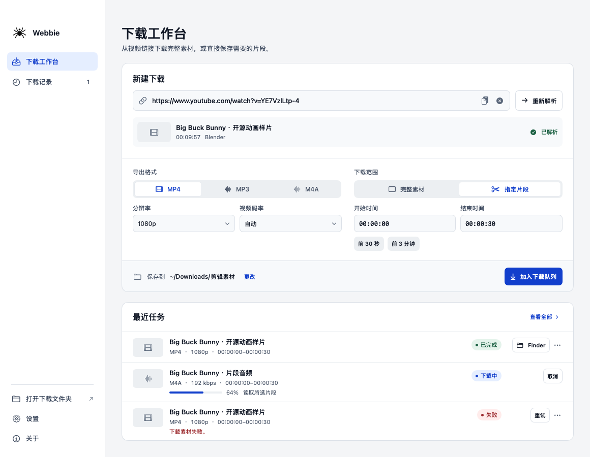

#  Webbie

**简体中文** · [English](README.en.md) · [日本語](README.ja.md)

> 一小时的视频，我剪片只用前 30 秒。

以前我得把整条视频下载下来，拖进剪辑软件，再去找早就记好的时间点。这个流程做多了，我就给自己做了 **Webbie**，一个能按时间段下载视频和音频的 macOS 工作台。

[**下载 Webbie for macOS**](https://github.com/raynpan316-cyber/webbie/releases/latest) · [安装指南](#安装) · [从源码构建](#从源码构建)

## 把前 30 秒存下来

1. **贴链接。** 把视频链接粘到工作台，点击「解析链接」。
2. **圈出要的部分。** 选「指定片段」，点「前 30 秒」。要取中间一段，就自己填起止时间。
3. **存到 Mac。** 选 MP4 和可用画质，加入下载队列。完成后，点任务旁的 **Finder** 就能找到成品。



## 剪片时还能这样用

- **访谈里听见一句能用的。** 填 `00:12:40 → 00:13:10`，就能导出那 30 秒。想留足开头的上下文，也可以用「前 3 分钟」预设。
- **画面不需要，声音要留。** 选 MP3 或 M4A，再选音频码率。只取某句对白时，同样可以指定片段。
- **手上有好几个素材。** 把任务放进同一个队列。视频可选分辨率和码率，任务失败后可从记录里重试，也能切回「完整素材」下载。

Webbie 可尝试解析 YouTube、B 站、TikTok、抖音、小红书等平台的链接。实际可用的画质、格式和片段下载能力随源站与具体链接而变，也受 yt-dlp 支持情况影响。下载和记录都在 Mac 上处理，界面可在「设置」中切换简体中文、英文和日文。

## 安装

需要 **Apple 芯片的 Mac** 和 **macOS 14 或更新版本**。

1. 安装 [Homebrew](https://brew.sh/)，然后在终端安装下载组件。

   ```bash
   brew install yt-dlp ffmpeg deno
   ```

2. 从 [Releases](https://github.com/raynpan316-cyber/webbie/releases) 下载 `Webbie-macOS-arm64.zip`。解压后，把 `Webbie.app` 移到「应用程序」。
3. 在访达的「应用程序」文件夹里双击 Webbie。

### 首次打开时提示「未打开 Webbie」

发布包使用 ad hoc 签名，尚未经过 Apple 公证。确认这份 `Webbie.app` 来自本仓库的 [GitHub Releases](https://github.com/raynpan316-cyber/webbie/releases) 后，可以这样打开。

1. 在弹窗左下角点 **「完成」**。
2. 打开 **系统设置 → 隐私与安全性**，往下滚到 **「安全性」**，找到 Webbie，点 **「仍要打开」**。
3. 在下一次弹窗点 **「打开」**。macOS 会记住这次放行，以后可以直接双击。

如果没看到「仍要打开」，回访达再双击一次 `Webbie.app`，然后马上回到设置查看。[Apple 官方说明](https://support.apple.com/zh-cn/102445)

## 从源码构建

用 `xcode-select --install` 安装 Xcode 命令行工具，再到仓库根目录运行下面的命令。

```bash
./build.sh
```

应用生成在 `build/Webbie.app`，使用前面安装的下载组件。如果装了多个 SDK，可用 `WEBBIE_SDK_PATH` 指定和 Swift 工具链匹配的 SDK。

## Build in Public

我是 [Rayn](https://github.com/raynpan316-cyber)。如果 Webbie 帮你少做了一道工序，欢迎点个 ⭐。你也可以在 [Issues](https://github.com/raynpan316-cyber/webbie/issues) 说说你平时怎样找素材。开发过程和更新会发在 [小红书](https://www.xiaohongshu.com/user/profile/5edcdd31000000000101cbdb) 和 [X](https://x.com/raynpann)。

Webbie 源码采用 [MIT 许可证](LICENSE)。[yt-dlp](https://github.com/yt-dlp/yt-dlp)、[FFmpeg](https://ffmpeg.org/) 和 [Deno](https://github.com/denoland/deno) 通过 Homebrew 单独安装，适用各自的许可证。
